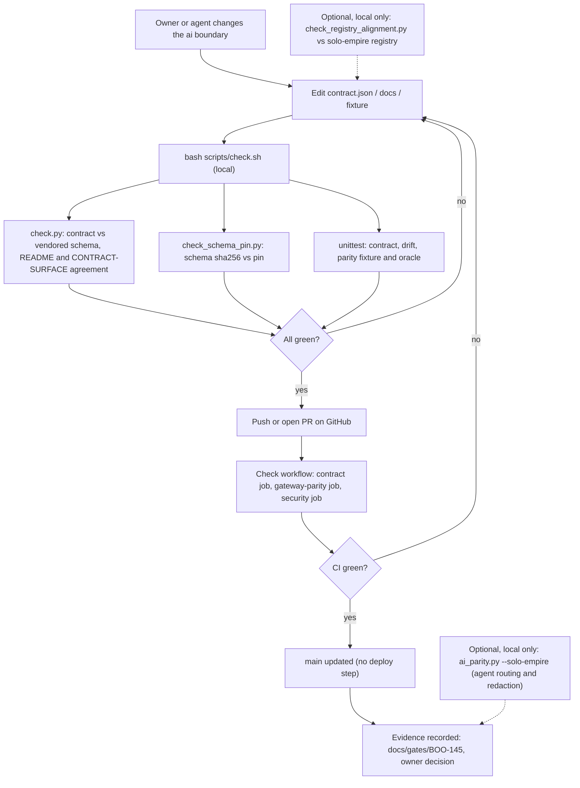
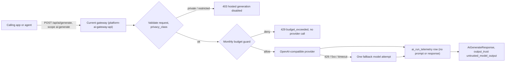
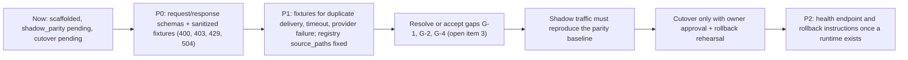

# 01 — Business process (As-Is / To-Be)

repo นี้เป็น **contract-only scaffold** ของ capability `ai` (LLM gateway, model routing, budget, prompt policy, RAG) ไม่มี runtime, ไม่มี provider integration, ไม่มี database writer (README "Scope", `contract.json` `status: scaffolded`) งานจริงที่ repo นี้ทำคือ "เขียนและตรวจ contract + เก็บหลักฐาน parity" ส่วนการให้บริการ AI จริงอยู่ที่ `bookchaowalit/platform-ai-gateway-api` (`contract.json` `current_implementation`)

## As-Is (จาก code วันนี้)

Sources: `README.md`, `PRODUCT.md`, `contract.json`, `scripts/check.sh`, `scripts/check.py`, `scripts/check_schema_pin.py`, `scripts/check_registry_alignment.py`, `scripts/ai_parity.py`, `.github/workflows/check.yml`, `docs/gates/BOO-145-provider-neutral-parity.md`

## Serving process ที่ boundary นี้ "ครอบ" (ทำงานที่ repo อื่น)

ภาพนี้คือ process ที่ contract บรรยายไว้ ไม่ได้รันใน repo นี้ (interfaces ทั้งหมด `status: current-in-solo-empire`)

Sources: `docs/CONTRACT-SURFACE.md` (Behaviour notes), `docs/gates/BOO-145-provider-neutral-parity.md` (Routing / Budget / Redaction inventory)

## To-Be (จากเอกสารใน repo เท่านั้น)

Sources: `docs/UPGRADE-PLAN.md` (Backlog P0–P2), `docs/gates/BOO-145-provider-neutral-parity.md` ("Owner decision", "Still open"), `README.md` ("Migration gate"), `contract.json` (`migration`)

หมายเหตุ: ops record: book-platforms-status (2026-11-03) บันทึกทางเลือกอื่นที่แนะนำ (ให้ gateway กลายเป็น ai service แล้ว archive scaffold นี้) แต่ยังเป็น **owner decision ที่เปิดอยู่** จึงไม่วาดเป็น To-Be

## Open questions

- เกณฑ์ cutover สำหรับเปิด runtime (`PRODUCT.md` Measures: "[ต้องยืนยัน]")
- จะย้าย implementation มาที่ repo นี้ หรือให้ `platform-ai-gateway-api` เป็น ai service แล้ว archive scaffold (ops record: book-platforms-status (2026-11-03), owner decision เปิดอยู่)
- RAG และ prompt policy อยู่ใน `capabilities` แต่ไม่มี interface ใดใน `contract.json` ครอบไว้ จะนิยามเมื่อไร
