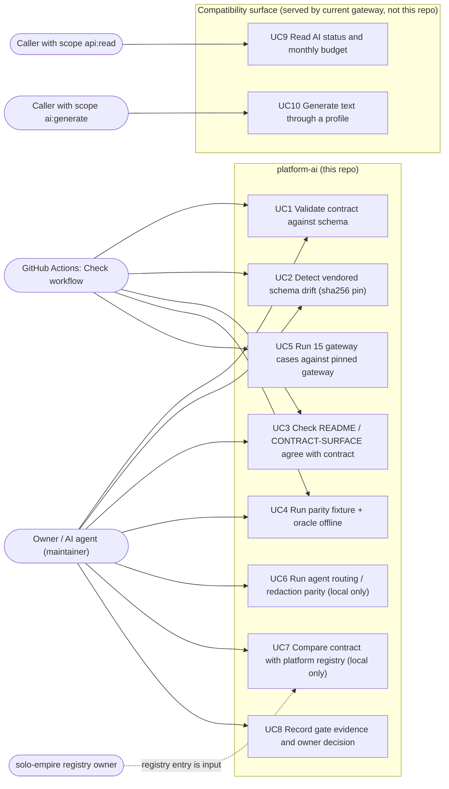

# 02 — Use cases

repo นี้ไม่มี auth level ของตัวเอง (ไม่มี runtime) actors จึงเป็นผู้ที่เรียก/รัน artefact ของ repo: owner/agents, GitHub Actions และ repo ข้างเคียง ส่วน actor ของ serving API (scope `api:read`, `ai:generate`) มาจาก contract และถูกบริการโดย gateway ปัจจุบัน

Sources: `scripts/check.sh`, `scripts/check.py`, `scripts/check_schema_pin.py`, `scripts/ai_parity.py` (`run`, `main`), `scripts/check_registry_alignment.py`, `.github/workflows/check.yml`, `contract.json` (`interfaces[].auth`), `docs/CONTRACT-SURFACE.md`, `docs/gates/BOO-145-provider-neutral-parity.md`

| Actor | มาจากไหนใน code | Use cases |
|---|---|---|
| Owner / agent | `PRODUCT.md` "Users" | UC1–UC4, UC6–UC8 |
| GitHub Actions | `.github/workflows/check.yml` jobs `contract`, `gateway-parity`, `security` | UC1–UC5 (+ security scan) |
| Registry owner | `scripts/check_registry_alignment.py` อ่าน `repository-catalog/registries/platforms.yaml` | input ของ UC7 |
| `api:read` caller | `contract.json` `ai.http.status.auth` | UC9 |
| `ai:generate` caller | `contract.json` `ai.http.generate.auth`, `ai.consumes.identity-bearer` | UC10 |

## Open questions

- consumer จริงของ `POST /api/ai/generate` คือใครบ้าง (central doc ระบุ "first client: EV3 web on Vercel" ใน architecture-docs `systems/ai-data/central-ai-gateway.md` "Hosted service" แต่ repo นี้ไม่มีรายชื่อ consumer)
