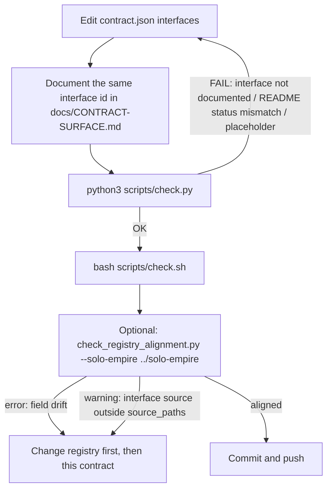
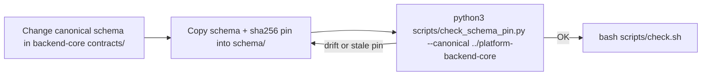
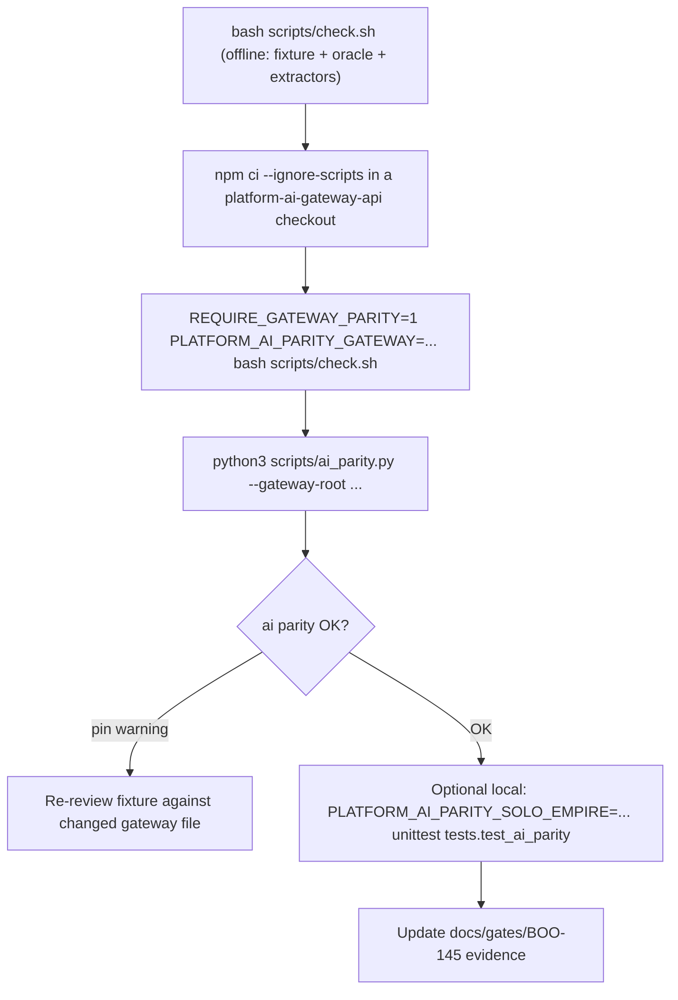

# 03 — User flows

ไม่มี routes หรือ pages (ไม่มี UI, ไม่มี HTTP server ใน repo) user flow จึงเป็น journey ของ maintainer ตามคำสั่งที่ README และ gate doc เขียนไว้

## Flow A — แก้ contract หรือ interface

Sources: `scripts/check.py` (`_semantic_errors`), `scripts/check_registry_alignment.py` (`compare`), `README.md` "Local verification", `docs/UPGRADE-PLAN.md` P1

## Flow B — เปลี่ยน shared schema

Sources: `README.md` (schema pin paragraph), `scripts/check_schema_pin.py`

## Flow C — Re-run parity gate (BOO-145)

Sources: `docs/gates/BOO-145-provider-neutral-parity.md` "Re-run", `scripts/ai_parity.py`, `tests/test_ai_parity.py`

## Open questions

- ไม่มี flow สำหรับ caller ของ AI API ใน repo นี้ ถ้าต้องการ user flow ของ app ที่เรียก gateway ต้องดูที่ `platform-ai-gateway-api` (ไม่ได้อ่านในรอบนี้)
