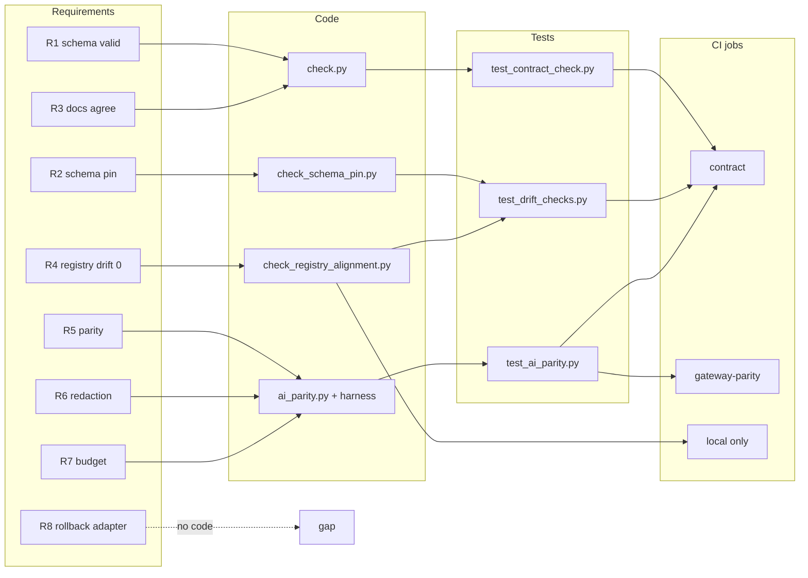

# 04 — Traceability (RTM)

ไม่มี `specs/` ใน repo requirement มาจาก `PRODUCT.md` (Purpose / Measures), `README.md` "Migration gate", `contract.json` `migration_gates` และ gate doc BOO-145 ไม่มี release/tag; "release" = merge เข้า `main` ที่ผ่าน workflow `Check`

| Req ID | Requirement (source) | Code module | Test file | CI / workflow |
|---|---|---|---|---|
| R1 | contract valid against pinned shared schema (`PRODUCT.md` Purpose) | `scripts/check.py` `validate_schema` | `tests/test_contract_check.py` (missing key, unknown key, unknown dependency, bool-not-int …) | `check.yml` job `contract` → `scripts/check.sh` |
| R2 | vendored schema matches canonical pin (`README.md`) | `scripts/check_schema_pin.py` | `tests/test_drift_checks.py` `SchemaPinTests` | `contract` |
| R3 | README + CONTRACT-SURFACE agree with contract (`README.md` Local verification) | `scripts/check.py` `_semantic_errors` | `test_readme_status_must_match_contract`, `test_undocumented_interface_fails` | `contract` |
| R4 | registry entry matches contract, drift target 0 (`PRODUCT.md` Measures) | `scripts/check_registry_alignment.py` | `tests/test_drift_checks.py` `RegistryAlignmentTests` | **local only** (not in CI, docstring) |
| R5 | provider-neutral parity gate (`migration_gates[0]`) | `scripts/ai_parity.py` `validate_fixture`, `check_oracle`, `compare_gateway`, `compare_routing` | `tests/test_ai_parity.py` `FixtureIntegrityTests`, `OracleTests`, `ExtractorTests`, `CurrentGatewayParityTests`, `CurrentAgentRoutingParityTests` | `contract` (offline) + `gateway-parity` (real gateway); routing part local only |
| R6 | redaction (`migration_gates[1]`, RD-1..RD-8) | `ai_parity.py` `oracle_redact`, `compare_gateway_cases` (canary leak check) | `test_synthetic_secret_canary_is_redacted`, `test_content_key_cannot_be_allowed_in_telemetry`, `test_gateway_case_comparison_flags_leaks` | `contract` + `gateway-parity` |
| R7 | budget enforcement (`migration_gates[2]`) | `ai_parity.py` `extract_budget_reasons`; harness cases `GW-BUDGET-*` | `test_budget_reason_classified_as_allow_fails`, `test_budget_denial_must_not_spend` | `contract` + `gateway-parity` |
| R8 | rollback adapter (`migration_gates[3]`) | none | none | none — **gap** |
| R9 | owner decision recorded, no cutover approved (gate doc) | `ai_parity.py` `validate_fixture` | `test_owner_decision_is_accepted_on_2026_10_16`, `test_owner_decision_cannot_approve_cutover`, `GateDocumentTests` | `contract` |
| R10 | P0 request/response schemas + fixtures 400/403/429/504 (`docs/UPGRADE-PLAN.md`) | none | none | none — **planned** |

Sources: `PRODUCT.md`, `README.md`, `contract.json`, `docs/UPGRADE-PLAN.md`, `docs/gates/BOO-145-provider-neutral-parity.md`, `scripts/*.py`, `tests/*.py`, `.github/workflows/check.yml`

## Open questions

- R8 "rollback adapter" ไม่มี code หรือ test ใด จะพิสูจน์อย่างไรก่อน cutover
- ควรให้ `check_registry_alignment.py` รันใน CI ไหม (ต้องมี read credential ของ solo-empire ซึ่งเป็น private)
