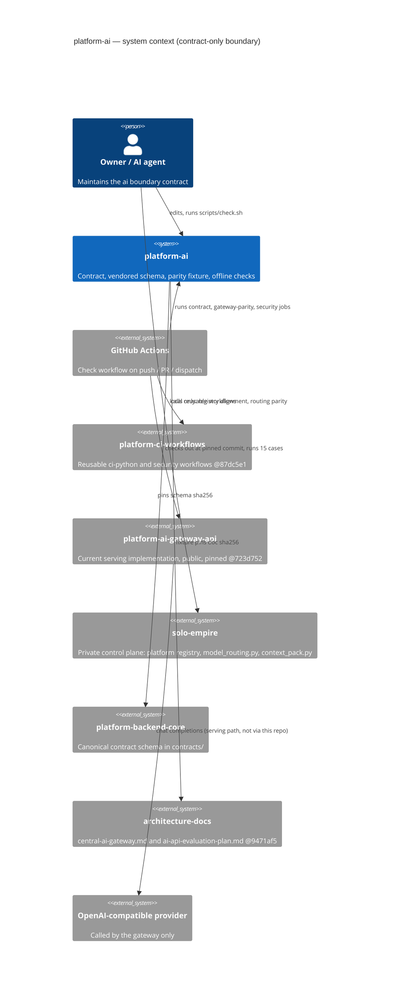

# 05 — C4 Context

System ในภาพคือ repo `platform-ai` (contract + evidence) ไม่ใช่ service ที่รันอยู่ ความสัมพันธ์ทั้งหมดเป็น build-time/check-time ยกเว้นเส้นประที่แสดง serving path ของ gateway ปัจจุบัน (ไม่ผ่าน repo นี้)

Sources: `contract.json`, `README.md`, `.github/workflows/check.yml`, `fixtures/gates/provider-neutral-parity.json` (`sources`), `scripts/check_schema_pin.py`, `scripts/check_registry_alignment.py`, `docs/gates/BOO-145-provider-neutral-parity.md`

ขอบเขต dependency ที่ contract ประกาศ (`depends_on`: `identity`, `data`, `security`, `observability`) เป็นเป้าหมายของ runtime ในอนาคต ยังไม่มีการเรียกจริงจาก repo นี้ จึงไม่วาดเป็น Rel

## Open questions

- เมื่อมี runtime จะเรียก `data` และ `observability` ผ่าน interface ใด (ไม่มี interface `consumes` ของสอง platform นี้ใน `contract.json`)
