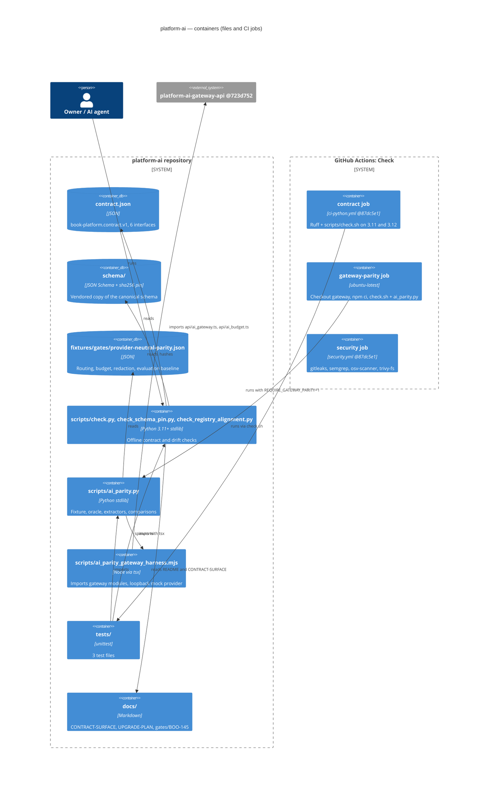

# 06 — C4 Container

"Container" ของ repo นี้คือ artefact และ CI jobs (ไม่มี process ที่รันถาวร)

Sources: `contract.json`, `schema/`, `fixtures/gates/provider-neutral-parity.json`, `scripts/*`, `tests/*`, `docs/*`, `.github/workflows/check.yml`, platform-ci-workflows `ci-python.yml` / `security.yml` @ `87dc5e1c`

## Open questions

- ไม่มี
