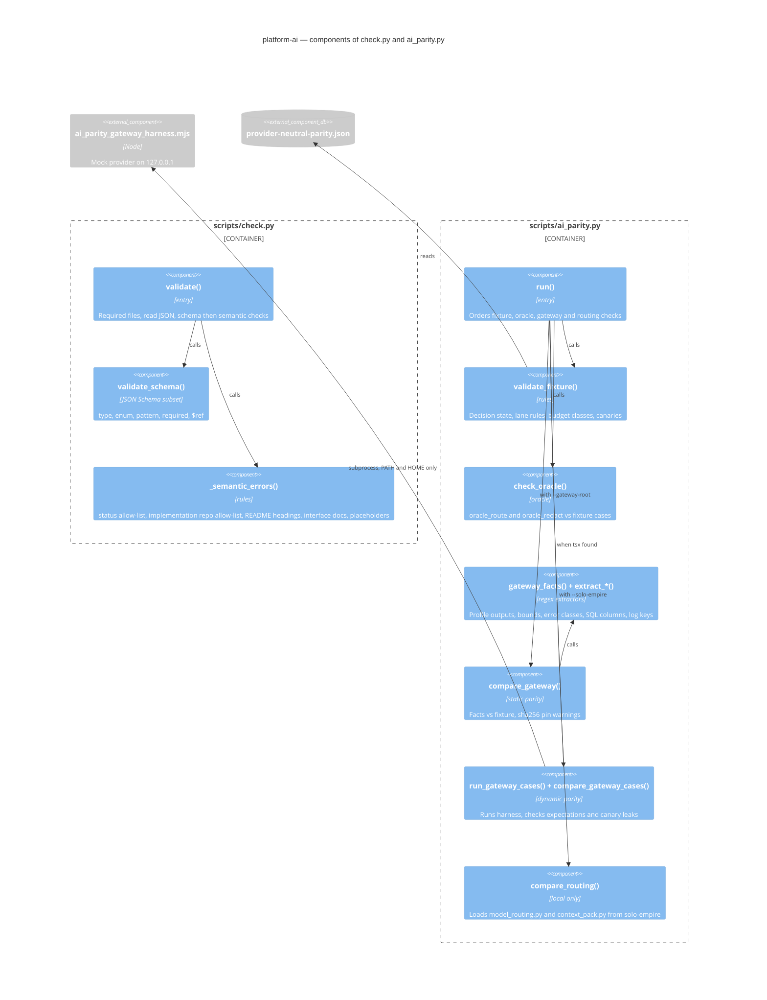

# 07 — C4 Component

Component ภายใน script หลักสองตัว (`scripts/check.py`, `scripts/ai_parity.py`) ตามชื่อฟังก์ชันจริง

Sources: `scripts/check.py`, `scripts/ai_parity.py` (functions L49–L631), `scripts/ai_parity_gateway_harness.mjs`

## Open questions

- ไม่มี
