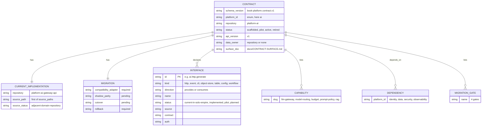
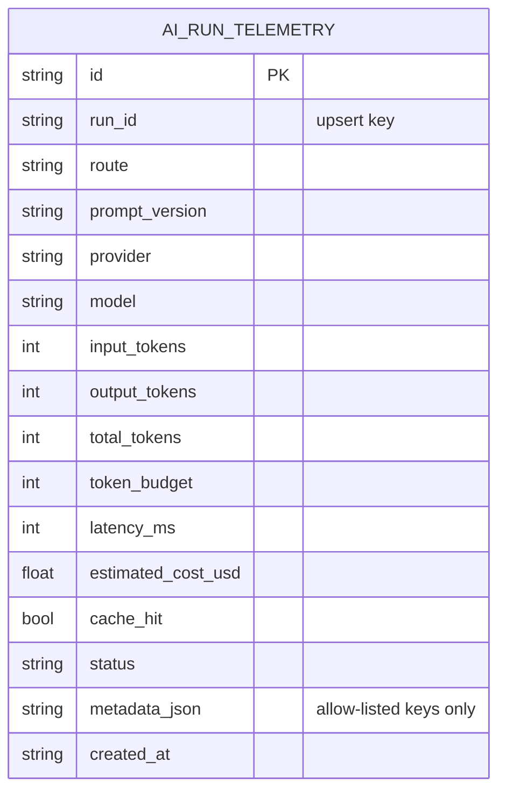
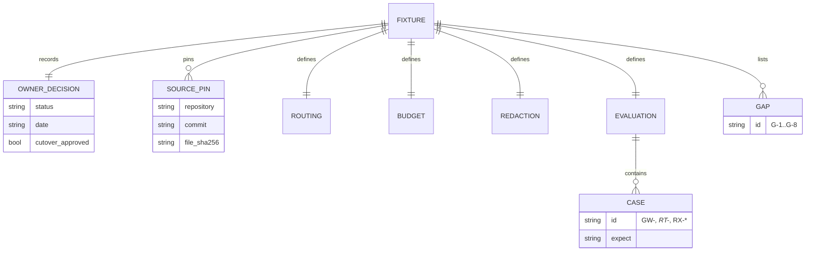

# 09 — ERD

repo นี้ **ไม่มี database** ข้อมูลที่ persist คือไฟล์ JSON ใน Git ภาพแรกจึงเป็น document model ของ `contract.json` ตาม schema ภาพที่สองคือตาราง `ai_run_telemetry` ซึ่งเป็น **compatibility surface** (interface `ai.event.run-telemetry`) ที่ gateway ปัจจุบันเป็นเจ้าของ คอลัมน์มาจาก fixture (`redaction.telemetry_columns`, ที่ extract จาก migration `025_ai_run_telemetry.sql` @ `723d752`) ไม่ใช่ migration ใน repo นี้

## A. Contract document (`contract.json` / `book-platform.contract.v1`)

Sources: `contract.json`, `schema/book-platform.contract.v1.schema.json` (`properties`, `$defs.interface`)

## B. `ai_run_telemetry` (compatibility surface, owned by the current gateway)

Sources: `fixtures/gates/provider-neutral-parity.json` (`redaction.telemetry_columns`, `redaction.telemetry_metadata_keys`), `contract.json` (`ai.event.run-telemetry`: "upsert on run_id"), `docs/CONTRACT-SURFACE.md` (telemetry never contains prompt or response bodies). ชนิดคอลัมน์เป็นการอนุมานจากชื่อ ไม่ได้อ่าน SQL จริง

## C. Parity fixture (top-level keys)

Sources: `fixtures/gates/provider-neutral-parity.json`, `scripts/ai_parity.py` (`validate_fixture`)

## Open questions

- ชนิดคอลัมน์จริงของ `ai_run_telemetry` (SQLite บน gateway) ต้องยืนยันจาก `database/migrations/025_ai_run_telemetry.sql` ใน `platform-ai-gateway-api`
- เมื่อ `data_owner: platform-ai` เริ่มมี runtime จะเก็บข้อมูลที่ไหน (Neon แยก project ตาม pattern ของ platform อื่น หรือ SQLite แบบ gateway)
