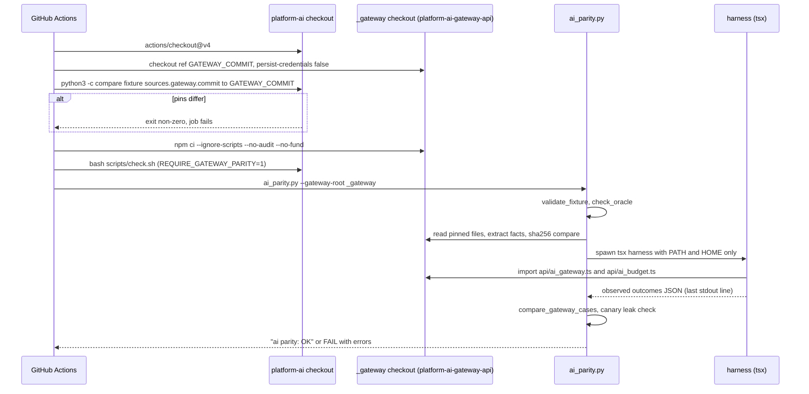
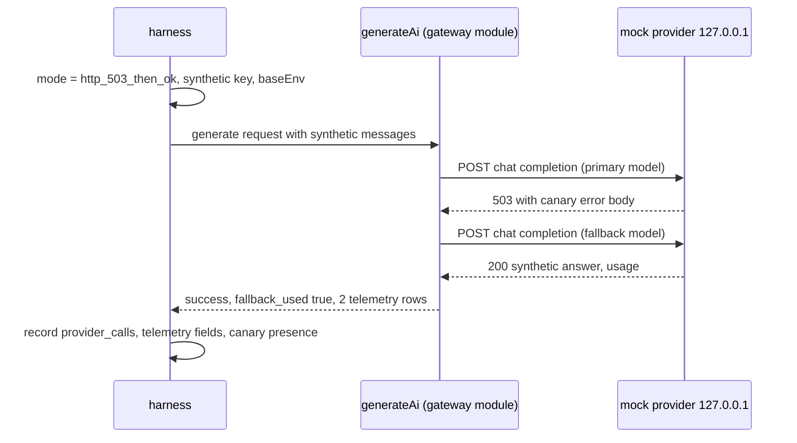
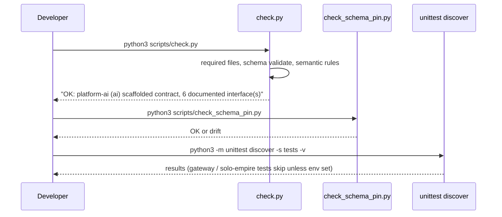
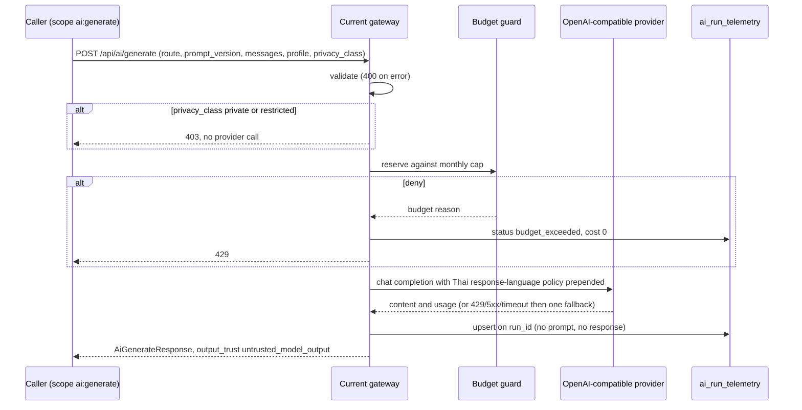

# 10 — Sequences

สาม path ที่สำคัญที่สุดของ repo นี้ (CI parity gate, harness case, local check) และหนึ่ง path ของ compatibility surface ที่ gateway ให้บริการ

## A. CI job `gateway-parity`

Sources: `.github/workflows/check.yml`, `scripts/ai_parity.py` (`run`, `run_gateway_cases`, `compare_gateway_cases`), `tests/test_ai_parity.py` (`CurrentGatewayParityTests`)

## B. One harness case (e.g. GW-FALLBACK)

Sources: `scripts/ai_parity_gateway_harness.mjs` (mock provider modes), `fixtures/gates/provider-neutral-parity.json` (`GW-FALLBACK` expect: `provider_calls: 2`, `telemetry_rows: 2`)

## C. Local `bash scripts/check.sh`

Sources: `scripts/check.sh`, `scripts/check.py` (`main`), `tests/test_ai_parity.py` (skip conditions)

## D. Compatibility surface: `POST /api/ai/generate` (served by the current gateway)

Sources: `docs/CONTRACT-SURFACE.md` "Behaviour notes", `docs/gates/BOO-145-provider-neutral-parity.md` (Budget fail-closed table, Routing inventory, RD-1..RD-4)

## Open questions

- ลำดับจริงระหว่าง rate limiter กับ budget guard ใน gateway ไม่ได้ระบุใน repo นี้ (CONTRACT-SURFACE ระบุเพียงว่ามี 429/503 จาก rate limiter)
