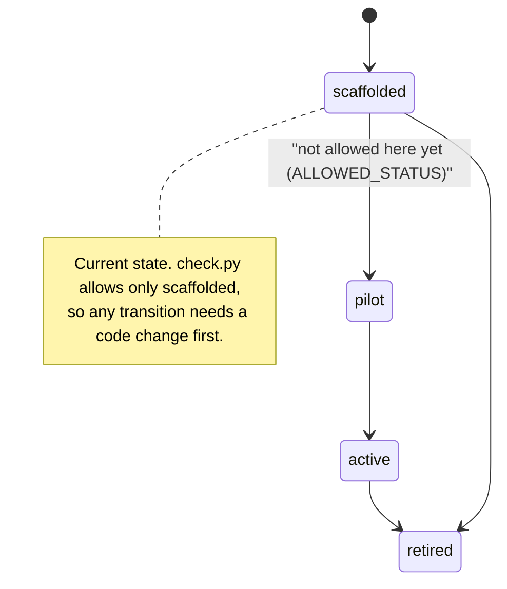
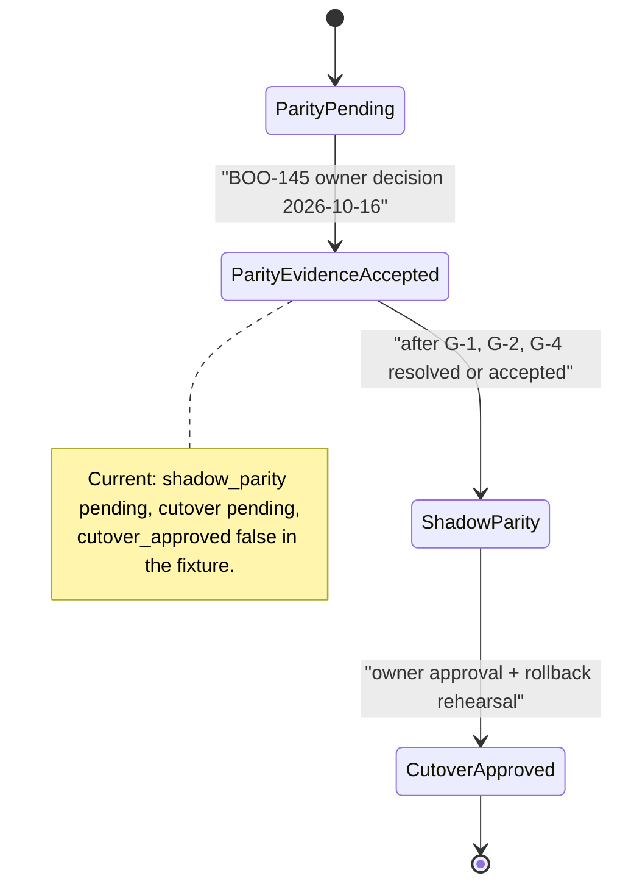
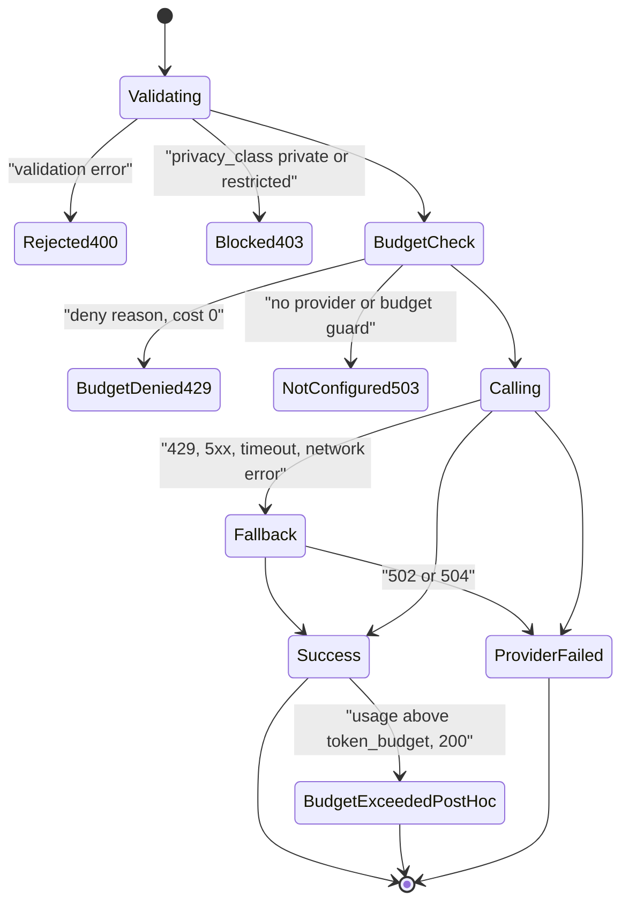

# 11 — State machines

entity ที่มี status/lifecycle ใน repo: `contract.status` (enum ใน schema), `migration.*`, `owner_decision` ใน fixture และ `status` ของ `AiGenerateResponse` (compatibility surface)

## A. Contract lifecycle (`status`)

Sources: `schema/book-platform.contract.v1.schema.json` (`status.enum`: scaffolded, pilot, active, retired), `scripts/check.py` (`ALLOWED_STATUS`), `contract.json`. การเปลี่ยนจาก state ใดไป state ใดเป็นได้บ้าง schema **ไม่ได้กำหนด** ลูกศรนอกจาก scaffolded คือลำดับตามชื่อ enum เท่านั้น

## B. Migration progression (`migration` + gate doc)

Sources: `contract.json` (`migration`), `fixtures/gates/provider-neutral-parity.json` (`owner_decision.cutover_approved`), `docs/gates/BOO-145-provider-neutral-parity.md`, `README.md` "Migration gate"

## C. Generate run outcome (compatibility surface)

Sources: `docs/CONTRACT-SURFACE.md` (Errors, Response `status`), `docs/gates/BOO-145-provider-neutral-parity.md` (fail-closed table), `fixtures/gates/provider-neutral-parity.json` (`GW-*` expectations, `routing.gateway.fallback_retryable`, `fallback_attempts_max: 1`)

## Open questions

- transition ที่อนุญาตของ `status` (pilot/active/retired) ยังไม่มีกฎใน schema หรือเอกสาร
