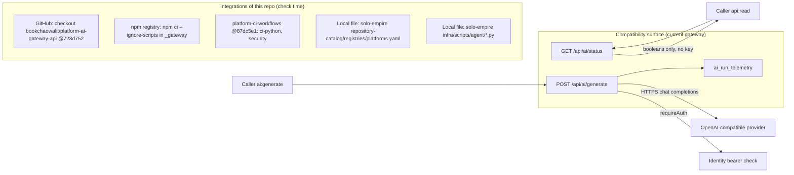

# 12 — API and integrations

**Reused:** ตาราง interfaces ครบถ้วนอยู่ใน [`docs/CONTRACT-SURFACE.md`](../CONTRACT-SURFACE.md) (ถูกบังคับโดย `scripts/check.py`: ทุก interface id ใน `contract.json` ต้องอยู่ในหน้านั้น) ไฟล์นี้เพิ่มภาพ integration ทั้งของ surface และของ repo เอง

repo นี้ **ไม่ serve endpoint ใด** interfaces ทั้ง 6 รายการ `status: current-in-solo-empire`

| ID | Direction | Interface | Auth |
|---|---|---|---|
| `ai.http.status` | provides | `GET /api/ai/status` | Bearer `api:read` |
| `ai.http.generate` | provides | `POST /api/ai/generate` | Bearer `ai:generate` |
| `ai.budget.status` | provides | budget status (embedded in status) | - |
| `ai.event.run-telemetry` | provides | `ai_run_telemetry` upsert on `run_id` | - |
| `ai.consumes.openai-compatible-provider` | consumes | chat completions, HTTPS only, no URL credentials | - |
| `ai.consumes.identity-bearer` | consumes | `requireAuth`, scope `ai:generate` | Bearer |

Sources: `contract.json` (`interfaces`), `docs/CONTRACT-SURFACE.md`, `.github/workflows/check.yml`, `scripts/check_registry_alignment.py` (`REGISTRY_RELATIVE`), `scripts/ai_parity.py` (`load_current_routing`, `load_current_context_pack`), `fixtures/gates/provider-neutral-parity.json` (`sources`)

## Drift ที่พบระหว่างเอกสาร

- `contract.json` บอก `current_implementation.repository: platform-ai-gateway-api` (`source_status: adjacent-domain-repository`) แต่ `docs/CONTRACT-SURFACE.md` ยังเขียน "source status: `current-implementation-in-solo-empire`" และ `source` ของทุก interface ยังเป็น path `infra/api/*.ts` ของ solo-empire ขณะที่ gate doc ระบุไฟล์ใน gateway เป็น `api/ai_gateway.ts` ฯลฯ

## Open questions

- ควรเปลี่ยน `source` ของ interfaces เป็น path ใน `platform-ai-gateway-api` หรือไม่ (เกี่ยวกับ open item 4 ของ gate doc: แก้ registry `source_paths` ก่อน)
- `GET /healthz` ที่ central doc (architecture-docs `systems/ai-data/central-ai-gateway.md` "Hosted service") ระบุว่า gateway expose ไม่อยู่ใน `contract.json` ควรเพิ่มไหม
