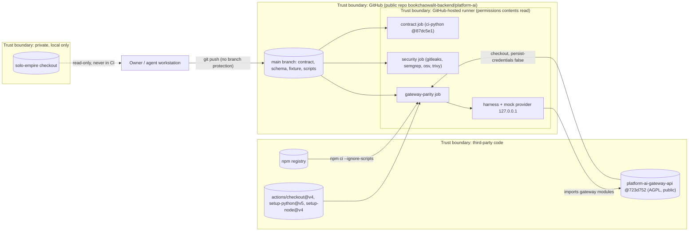

# 13 — Threat model (DFD + STRIDE)

ไม่มี runtime ใน repo นี้ พื้นผิวเสี่ยงจริงคือ **CI supply chain** (repo public รัน code ของ repo อื่นใน CI) และ **ความถูกต้องของ contract/evidence** ส่วนที่สองของตารางคือ threat ของ compatibility surface ตามที่ gate doc บันทึก เพื่อให้ runtime ในอนาคตต้องรักษา mitigation เดิม

Sources: `.github/workflows/check.yml`, `scripts/ai_parity.py` (`run_gateway_cases` env), `scripts/ai_parity_gateway_harness.mjs`, `scripts/check_registry_alignment.py`, platform-ci-workflows `security.yml` @ `87dc5e1c`, `gh api repos/bookchaowalit-backend/platform-ai/branches/main/protection` (404 "Branch not protected", 2026-11-03), `gh api .../rulesets` (0)

## STRIDE — repo / CI elements

| Element | S | T | R | I | D | E | Existing mitigation (code) | Gap |
|---|---|---|---|---|---|---|---|---|
| `main` branch | push as owner | tamper contract to fake parity | git history only | — | — | direct push to main | CI on every push; `test_owner_decision_cannot_approve_cutover` | no branch protection / ruleset; CI is not a required gate |
| gateway checkout in CI | wrong repo/commit | changed gateway code | — | — | — | gateway code runs on runner | `GATEWAY_COMMIT` must equal fixture pin; sha256 per pinned file (error with `REQUIRE_GATEWAY_PARITY=1`); `persist-credentials: false`; `permissions: contents: read` | gateway `main` drift not watched |
| npm dependencies | typosquat | malicious package | — | — | — | install scripts | `npm ci` (lockfile) with `--ignore-scripts` | packages still execute when tsx runs the harness |
| GitHub actions in `gateway-parity` | — | moved tag | — | — | — | — | shared workflows pin actions by SHA | `actions/checkout@v4`, `setup-python@v5`, `setup-node@v4` are tag-pinned, not SHA-pinned |
| harness | — | — | — | leak env secrets | hang | — | subprocess env = `PATH` + `HOME` only; synthetic key `sk-SYNTHETIC-...`; loopback mock; `timeout=120`; job `timeout-minutes: 10` | — |
| fixture canaries | — | — | — | real secret committed | — | — | `test_canaries_must_be_synthetic`; gitleaks in `security` job | — |
| vendored schema | — | silent drift | — | — | — | — | `check_schema_pin.py` sha256 | canonical compare only with `--canonical` (local) |
| solo-empire parity | — | routing code changes unnoticed | — | private code | — | — | read-only, local only | not enforced in CI (gate doc "Not done") |

## STRIDE — compatibility surface (served by current gateway, recorded in gate doc)

| Element | Threat | Mitigation recorded | Gap |
|---|---|---|---|
| `POST /api/ai/generate` | S: unauthenticated caller | Bearer scope `ai:generate` (`ai.consumes.identity-bearer`) | missing-auth case not re-run by harness (G-8) |
| provider call | I: private data sent to hosted provider | RD-4: `private`/`restricted` → 403 before any hosted call | RD-8 / G-4: secrets or PII inside messages are not scrubbed |
| provider error | I: provider body leaked | RD-2: error bodies drained, never returned/logged | — |
| status endpoint | I: key exposure | RD-3: booleans only, URL with credentials refused | — |
| telemetry | I: prompt/response stored | RD-1: scalar metadata only; allow-listed keys | — |
| budget | D / financial: runaway spend | fail-closed guard, 429 before provider call | G-5: guard and limiter process-local (single replica) |
| model output | T: prompt-injected output trusted | `output_trust: untrusted_model_output` | consumer handling not in scope |

Sources: `docs/gates/BOO-145-provider-neutral-parity.md` (Redaction inventory, Budget inventory, Gaps), `docs/CONTRACT-SURFACE.md`, `contract.json`

## Open questions

- จะเปิด branch protection หรือ ruleset ให้ `main` และบังคับ `Check` เป็น required status ไหม
- จะ pin `actions/checkout`, `setup-python`, `setup-node` ใน job `gateway-parity` ด้วย SHA ตามมาตรฐาน shared CI ไหม
- RD-8 จะเป็น accepted risk ("caller-declared privacy class only") หรือเพิ่ม pre-provider scrubber (open item 3 ของ gate doc)
