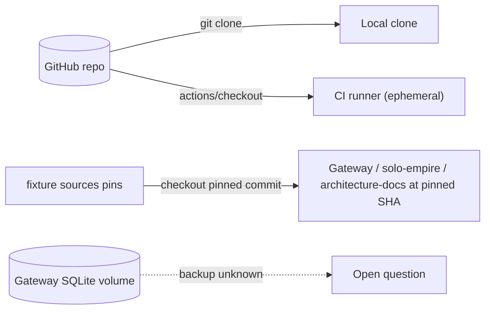

# 14 — Backup and DR

**Status: not_applicable (runtime)** — repo นี้ไม่มี persisted runtime data (`README.md`: no database writer, no customer payload; `PRODUCT.md`: nothing runs in production) ข้อมูลทั้งหมดเป็นไฟล์ใน Git

| Data | Where it lives | Backup / restore reality | RTO / RPO |
|---|---|---|---|
| `contract.json`, schema, fixture, docs, scripts | GitHub `bookchaowalit-backend/platform-ai` (public) + local clones | Git history; restore = clone / checkout a commit | not defined |
| Canonical schema | `platform-backend-core` `contracts/` | pin in `schema/*.sha256` detects mismatch | not defined |
| Parity sources | gateway @ `723d752`, solo-empire @ `63efeeb`, architecture-docs @ `9471af5` | commits + sha256 pinned in fixture `sources`; restore = checkout pinned commit | not defined |
| `ai_run_telemetry` (compatibility surface) | current gateway: SQLite on a volume (architecture-docs `systems/ai-data/central-ai-gateway.md` "Hosted service") | not in this repo; not verified | not defined |

Sources: `README.md`, `PRODUCT.md`, `fixtures/gates/provider-neutral-parity.json` (`sources`), `schema/book-platform.contract.v1.schema.json.sha256`, architecture-docs `systems/ai-data/central-ai-gateway.md` (@ `eeb0969` local read)

## Open questions

- gateway ปัจจุบันมี backup ของ SQLite volume หรือไม่ (ไม่อยู่ใน repo นี้; ops record: prod-baseline-monitoring-backups ไม่ได้ระบุ gateway)
- เมื่อมี runtime จะใช้ RTO/RPO เท่าไร (README "Migration gate" กำหนดเพียง "rehearse rollback on a disposable state store")
