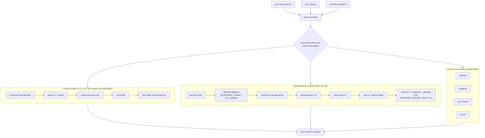

# 15 — CI/CD pipeline

workflow เดียว `.github/workflows/check.yml` (name `Check`) ไม่มี CD — ไม่มี deploy job ใด ๆ

Sources: `.github/workflows/check.yml`, platform-ci-workflows `.github/workflows/ci-python.yml` and `security.yml` @ `87dc5e1c` (steps Lint `if: inputs.lint-command != ''`, Typecheck skipped because `typecheck-command: ""`, PostgreSQL `if: inputs.postgres` not set, default runner `"ubuntu-24.04"`), `gh run view` of the latest run (7 jobs success, 2026-10-22)

หมายเหตุ: ไม่มี `needs:` ระหว่าง jobs ทั้งสามรันขนาน `format-check: false` และไม่มี typecheck ตาม comment "follow-up" ใน workflow

## Open questions

- ควรเพิ่ม scheduled run เพื่อจับ drift ของ gateway `main` ไหม (gate doc "Not done")
