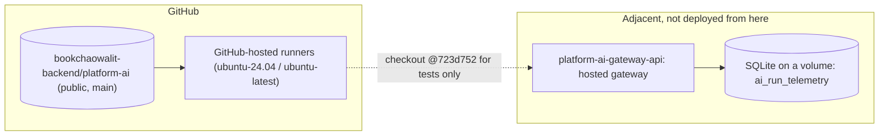

# 16 — Deployment

**Status: not_applicable (no hosted runtime)** — ไม่มี Dockerfile, `railway.toml`, `wrangler.toml`, Vercel config หรือ deploy job ใน repo (`PRODUCT.md`: "nothing runs in production"; DOCPACK product card: "deploy config: ไม่มี", "Live URL: ไม่มี") ภาพนี้แสดงที่อยู่ของ artefact และ serving implementation ที่อยู่ข้างเคียง

Sources: `PRODUCT.md` "Operating Context", `README.md` ("published; runtime not activated"), `DOCPACK/00-product-card.md` §4, `.github/workflows/check.yml`, architecture-docs `systems/ai-data/central-ai-gateway.md` "Hosted service" (single replica, SQLite on a volume, Railway runbook link), ops record: book-platforms-status (2026-11-03) ("live bookchaowalit/platform-ai-gateway-api (Node, always-on Railway + SQLite, static hashed tokens)")

## Open questions

- runtime ในอนาคตจะเป็น always-on หรือ serverless + Neon (ops record: book-platforms-status (2026-11-03) ระบุว่าเป็น owner decision)
- org transfer ของ gateway ไป `bookchaowalit-backend` (owner decision เปิดอยู่ ตาม ops record เดียวกัน)
