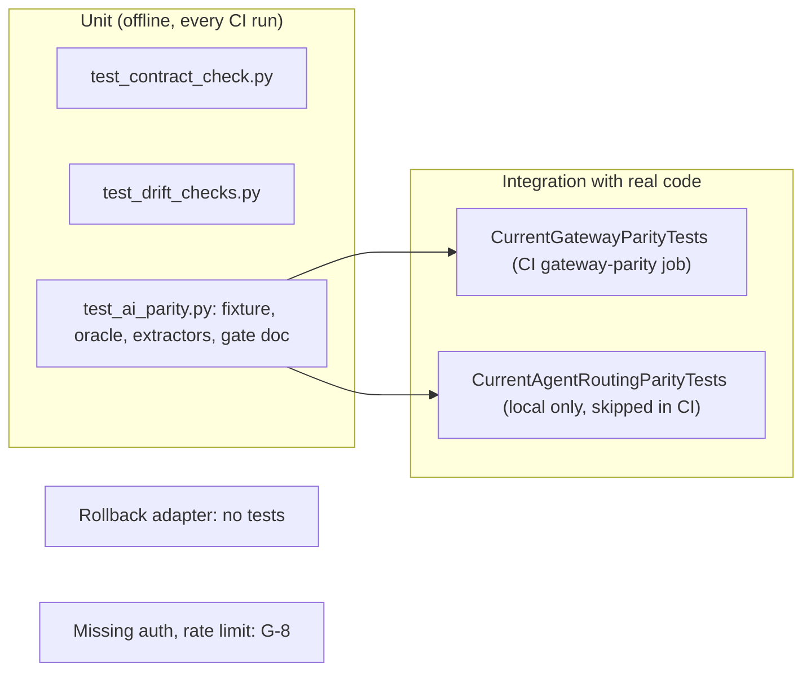

# 17 — Test coverage matrix

test ทั้งหมดใช้ `unittest` (3 ไฟล์, 68 tests: 21 + 17 + 30) ไม่มี coverage tool (`coverage-threshold` ไม่ได้ตั้งใน `check.yml`) "integration" ในตารางหมายถึง test ที่รันกับ code จริงของ repo อื่น (gateway / solo-empire) ไม่มี e2e เพราะไม่มี runtime

| Feature | Unit (offline) | Integration (real code) | E2E | CI? |
|---|---|---|---|---|
| Contract schema validation | `test_contract_check.py` (21 tests: required key, unknown key, unknown dependency, self dependency, duplicate capability, bool-not-int, invalid JSON, missing schema …) | — | n/a | yes (`contract`) |
| README / CONTRACT-SURFACE agreement | `test_readme_status_must_match_contract`, `test_undocumented_interface_fails`, `test_duplicate_interface_id_fails` | — | n/a | yes |
| Implementation-repo allow-list | `test_canonical_adjacent_implementation_is_accepted`, `test_unregistered_adjacent_implementation_is_rejected` | — | n/a | yes |
| Schema pin | `test_drift_checks.py` `SchemaPinTests` (10) | `--canonical` only locally | n/a | unit yes |
| Registry alignment | `RegistryAlignmentTests` (7, synthetic registry) | `check_registry_alignment.py --solo-empire` | n/a | unit yes; real **no** |
| Parity fixture integrity | `FixtureIntegrityTests` (13) | — | n/a | yes |
| Routing / redaction oracle | `OracleTests` (5) | `CurrentAgentRoutingParityTests` (14 RT + 8 RX vs solo-empire) | n/a | oracle yes; real **local only** |
| Gateway extractors | `ExtractorTests` (6, made-up TypeScript) | `CurrentGatewayParityTests.test_static_facts_match_fixture` | n/a | yes (`gateway-parity`) |
| Gateway behaviour (15 GW cases) | `test_gateway_case_comparison_flags_leaks` | `test_gateway_cases_against_real_code` + `ai_parity.py --gateway-root` | n/a | yes (`gateway-parity`) |
| Gate doc consistency | `GateDocumentTests` (3) | — | n/a | yes |
| Rollback adapter (gate 4) | **none** | **none** | n/a | **gap** |
| Missing-auth, rate/concurrency (eval scenarios) | — | **not re-run** (G-8) | n/a | **gap** |

Sources: `tests/test_contract_check.py`, `tests/test_drift_checks.py`, `tests/test_ai_parity.py` (class and test names, skip conditions), `.github/workflows/check.yml`, `docs/gates/BOO-145-provider-neutral-parity.md` (G-8, "Where parity is enforced")

## Open questions

- จะวัด coverage ของ `scripts/` ไหม (shared CI v1.1.0+ มี coverage gate แบบ opt-in แต่ repo ไม่ได้เปิด)
