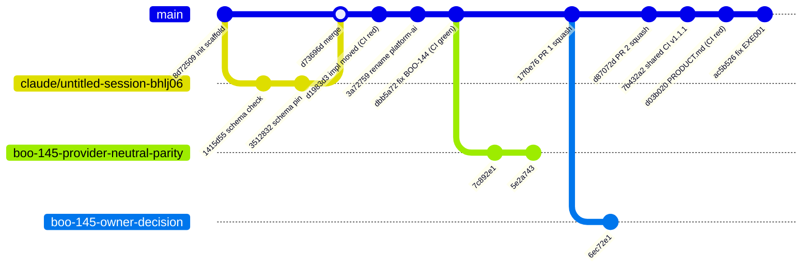
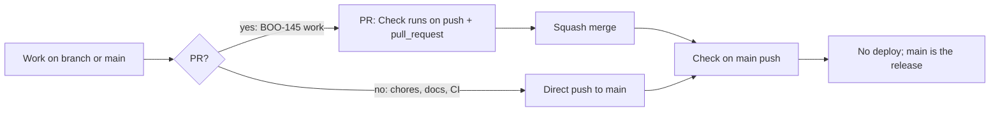

# 18 — Git and release workflow

ไม่มี tag หรือ release (`git tag` ว่าง) "production" ของ repo นี้คือ `main` ที่ผ่าน `Check` ไม่มี deploy trigger ประวัติแสดงสองแบบ: direct push ไป `main` (ส่วนใหญ่) และ PR แบบ squash (PR #1, #2 สำหรับ BOO-145)

Sources: `git log --format='%h %ad %s' origin/main` (21 commits, 2026-09-17 → 2026-10-22), `gh pr list -R bookchaowalit-backend/platform-ai --state all` (PR #1, #2 merged), `gh run list` (head SHAs of branch runs), `gh api .../branches/main/protection` (not protected), `.github/workflows/check.yml`

หมายเหตุ: gitGraph ย่อ commit chore บางตัว (f96a543, a98eca8, c0f3c32, 5a2506c, 92e9779, cba1df2, 1d67e13, 4d30ac4) เพื่อให้อ่านง่าย ตำแหน่งของ branch commits ของ PR เป็นการวาดเชิงตรรกะ

## Open questions

- ต้องการให้งานทุกชิ้นผ่าน PR (และ Codex/owner review) หรือ direct push ยังยอมรับได้สำหรับ scaffold
