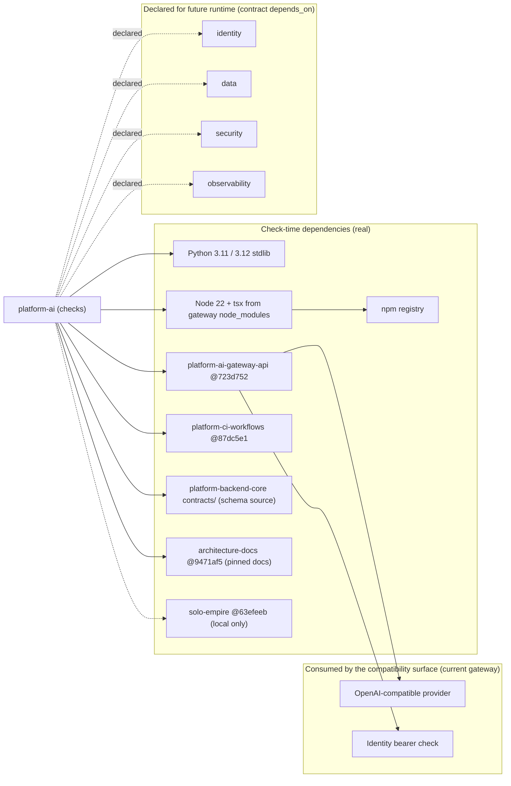

# 19 — Service dependency map

ไม่มี runtime dependency (ไม่มี service ที่รัน) dependency ทั้งหมดเป็น check-time ส่วน `depends_on` ใน contract คือ dependency ที่ประกาศไว้สำหรับ runtime อนาคต

Sources: `contract.json` (`depends_on`, `interfaces` consumes), `.github/workflows/check.yml`, `scripts/ai_parity.py`, `scripts/check_schema_pin.py`, `fixtures/gates/provider-neutral-parity.json` (`sources`), `README.md`

หมายเหตุ: ops record: book-platforms-status (2026-11-03) ระบุว่า gateway ใช้ static hashed tokens และ identity client `ai-gateway` ยังไม่ได้สร้าง ดังนั้นเส้น "Identity bearer check" ในวันนี้ไม่ใช่ platform-identity

## Open questions

- runtime ในอนาคตจะใช้ identity JWKS (audience `ai-api`) แทน static tokens หรือไม่ (owner decision ตาม ops record เดียวกัน)
