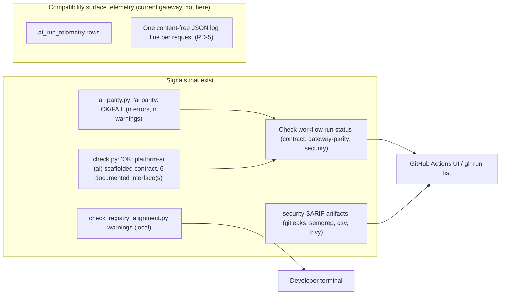

# 20 — Observability

**Runtime: not_applicable** — `PRODUCT.md`: "Sentry does not apply: nothing runs in production. Add it in the change that activates a runtime." ไม่มี Sentry, PostHog, uptime target หรือ heartbeat ใน repo สัญญาณที่มีจริงคือผลของ CI และ warnings จาก scripts

Sources: `PRODUCT.md`, `.github/workflows/check.yml`, `scripts/ai_parity.py` (`main`), `scripts/check.py` (`main`), platform-ci-workflows `security.yml` @ `87dc5e1c` (upload-artifact `*-sarif`), `docs/CONTRACT-SURFACE.md`, `docs/gates/BOO-145-provider-neutral-parity.md` (RD-5)

## What is watched

| Watched | By | Alert channel |
|---|---|---|
| contract / parity / security on push | GitHub Actions | none configured in repo (GitHub default notifications only) |
| gateway drift on `main` | nobody | — (gate doc "Not done") |
| solo-empire routing drift | nobody in CI | — |

## Open questions

- ต้องการ alert (เช่น Telegram แบบ repo อื่น) เมื่อ `Check` บน `main` แดงหรือไม่
- G-6: provider quality, p50/p95 latency, rate-card reconciliation ยังไม่มีการวัด
