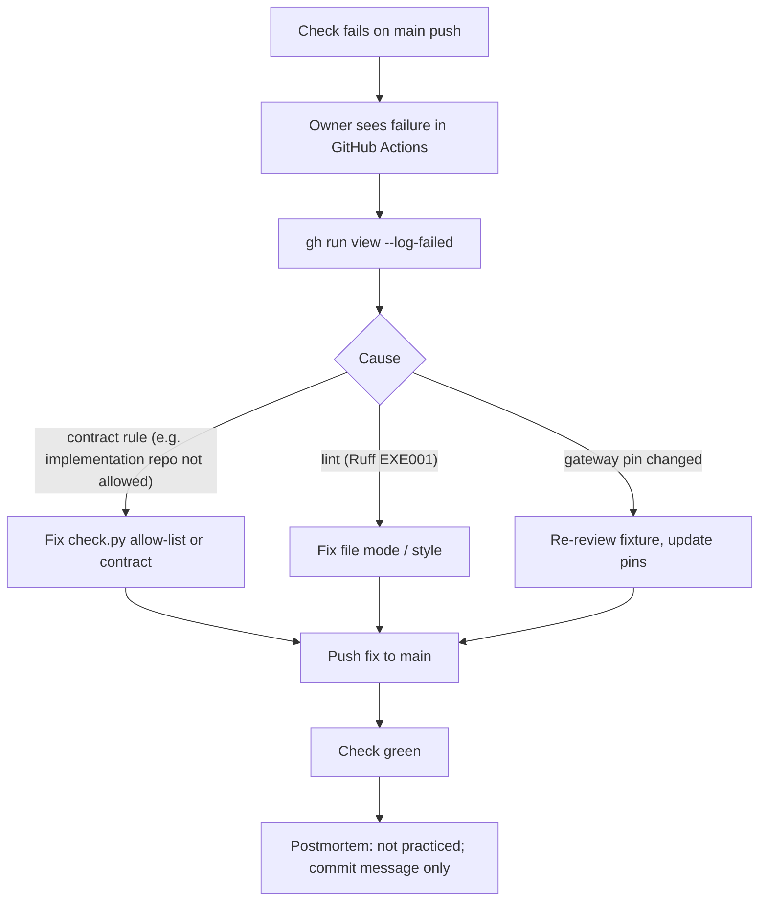

# 21 — Incident response

**Status: not_applicable** — ไม่มี production runtime จึงไม่มี production incident และไม่พบ alert channel ใน repo (ไม่มี Sentry, uptime, heartbeat, Telegram) incident ที่เกิดได้จริงคือ "main แดง" หรือ "parity drift" ภาพด้านล่างคือ flow ที่สังเกตได้จากประวัติ CI ไม่ใช่ runbook ที่ตกลงกันไว้

ตัวอย่างจริง: (1) `d1983d3` 2026-10-11 → แดง 9 runs ("current_implementation.repository must be one of ['book-ai-platform', 'solo-empire']") → แก้ใน `dbb5a72` 2026-10-15; (2) `d03b020` 2026-10-22 Ruff EXE001 → แก้ใน `ac5b526` ภายใน ~4 นาที

Sources: `gh run list -R bookchaowalit-backend/platform-ai --branch main --event push`, `gh run view --log-failed` ของ run `d1983d3` และ `d03b020`, `git log origin/main`

## Open questions

- เมื่อ runtime เปิด จะใช้ alert/incident flow เดียวกับ platform อื่น (uptime worker + Sentry + Telegram) หรือไม่
- red main ค้าง 4 วัน (2026-10-11 → 10-15) ไม่มีใครถูกแจ้ง ควรมี alert ไหม
