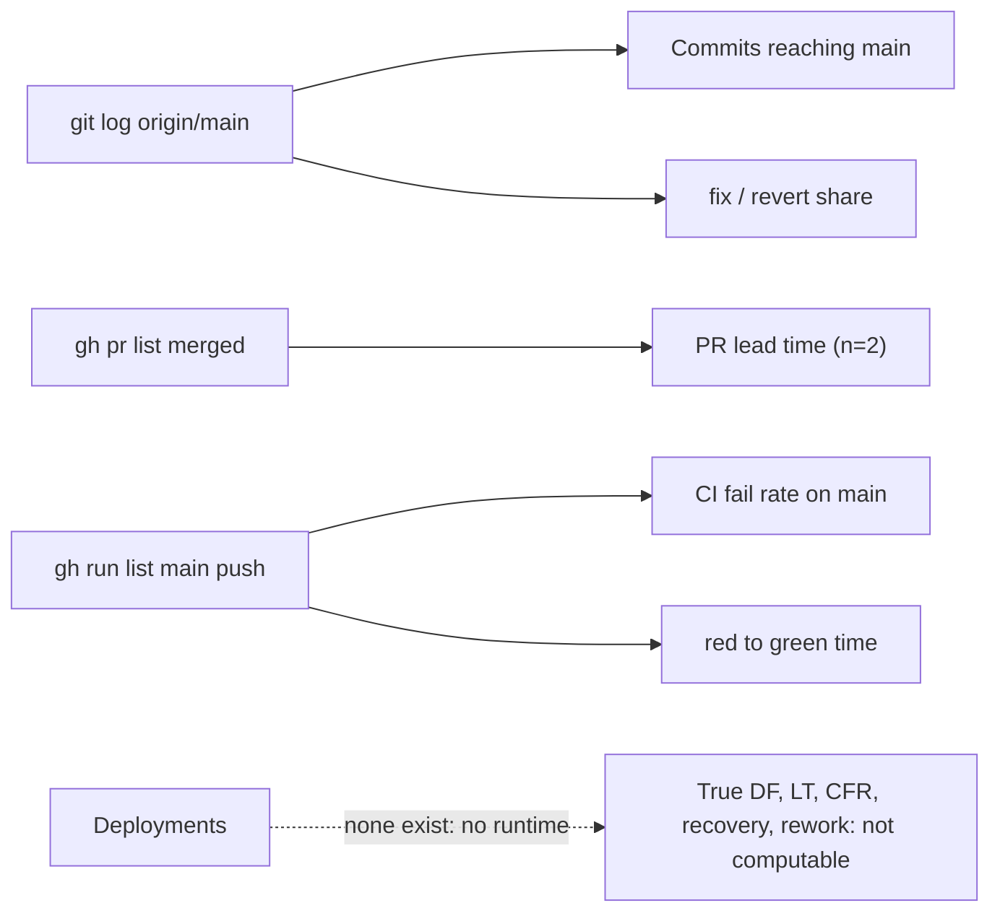

# 22 — DORA metrics

หน้าต่าง: 90 วันถึง 2026-11-03 (`--since=90.days`; repo เริ่ม 2026-09-17 จึงครอบทั้งประวัติ) repo นี้ **ไม่มี deploy** (ไม่มี deploy config/job, ADR-0001) ดังนั้น metric ที่ผูกกับ deployment วัดแบบแท้จริงไม่ได้ ใช้ proxy "change reaching `main`" และ CI บน `main` แทน GitHub Actions เห็น run ย้อนหลังถึง 2026-10-01 เท่านั้น

| Metric | How to measure for this repo | Current value (90 d) | Command | Confidence |
|---|---|---|---|---|
| Deployment frequency | ไม่มี deployment → **cannot compute**. Proxy: commits reaching `main` | **0 deploys**. Proxy: 21 commits on `main` (1 merge commit that brought 3 branch commits, 2 squash-merged PRs, the other 14 direct pushes) | `git log --since=90.days --oneline origin/main \| wc -l` ; `git log --since=90.days --merges --oneline origin/main \| wc -l` | proxy only |
| Lead time for changes | commit → deploy ไม่มี; proxy = PR open → merge | **5.9 min** (PR #2) และ **10.8 min** (PR #1); direct pushes ไม่มี lead time ให้วัด | `gh pr list -R bookchaowalit-backend/platform-ai --state merged -L 50 --json createdAt,mergedAt --jq '[.[]\|((.mergedAt\|fromdate)-(.createdAt\|fromdate))/60]\|sort'` | low: n = 2 |
| Change fail rate | ควรเป็น deploys ที่ทำให้ prod เสีย; proxy = `Check` failures บน push to `main` | **9 / 14 = 64 %** (8 consecutive from `d1983d3` to `cba1df2`, plus `d03b020`) | `gh run list -R bookchaowalit-backend/platform-ai --branch main --event push -L 200 --json conclusion --jq 'group_by(.conclusion)\|map({c:.[0].conclusion,n:length})'` | medium for CI; prod n/a |
| Failed deployment recovery time | ไม่มี deployment; proxy = first red `main` run → next green `main` run (createdAt → updatedAt) | **4 d 0 h 45 m** (2026-10-11 05:33:20Z → 2026-10-15 06:18:34Z, fix `dbb5a72`) และ **3 m 40 s** (2026-10-22 09:41:10Z → 09:44:50Z, fix `ac5b526`) | `gh run list -R bookchaowalit-backend/platform-ai --branch main --event push -L 30 --json createdAt,updatedAt,conclusion,headSha` | CI proxy only |
| Deployment rework rate | ไม่มี deployment; proxy = share of non-merge commits on `main` whose subject starts `fix` / `revert` | **3 / 20 = 15 %** (`92e9779`, `dbb5a72`, `ac5b526`) | `git log --since=90.days --no-merges --format=%s origin/main \| grep -ciE '^(fix\|revert)'` ; `git log --since=90.days --no-merges --oneline origin/main \| wc -l` | low: CI rework, not deploy rework |

หมายเหตุ: 8 runs แดงติดกันเกิดจาก `check.py` ไม่ยอมรับ `current_implementation.repository` ที่เปลี่ยนเป็น gateway (log: "current_implementation.repository must be one of ['book-ai-platform', 'solo-empire']") ระหว่างนั้นมีการ push chore ต่อโดยไม่แก้ CI

Sources: `git log origin/main` (at `ac5b526`), `gh pr list`, `gh run list`, `gh run view --log-failed` (runs `d1983d3`, `d03b020`), ADR-0001

## Open questions

- เมื่อมี runtime จะบันทึก deploy (เช่น Railway deployment list หรือ `SENTRY_RELEASE`) ที่ไหนเพื่อให้คำนวณ DORA แท้ได้
